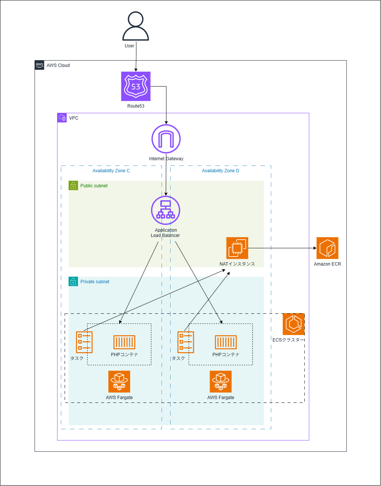

# practice-github-actions

# 説明
AWSの学習で触った内容をTerraformでコード化して整理。  
コード化したAWSインフラをGithub Actionsで自動構築と削除するまでを実践しました。

## 学んだこと
- VPC周りのサービス（サブネット、ルートテーブル、セキュリティグループなど）  
- NATインスタンスの構築(NAT設定、ec2起動テンプレート)  
- ALBでの負荷分散(ターゲットグループ)  
- DockerイメージとECS、ECRの役割
- ドメイン取得とhttps化
- インフラのコード化と自動構築、Github Actionsワークフロー

## 実践した内容
- PHPコンテナのWebアプリケーションを想定してインフラを構築。  
- ALBで負荷分散、コンテナ技術の理解のために、Docker、ECS Fargateを使用。  
- WebサイトにAWSタスクIDを表示することで、アクセスの分散が出来ているか確認。  
- Teraformの実行をローカルから、Github Actionsに移行する際に、terraform.tfstateをS3に配置。  
- ユーザーとALBまでをhttpsで通信できるように、ドメインを取得してACMで証明書発行、Route53でドメインとALBを紐付け。  
- コンテナイメージをECSタスクがECRリポジトリまで取りに行けるようにNATインスタンス経由でプライベートサブネットから通信可能にする。  
- ECRリポジトリがないとコンテナイメージのpushが出来ないが、インフラを一括で構築するにはイメージが必要になるため、エラーが出る。  
→GithubActionsのワークフローを変更して、先にECRリポジトリを作成し、イメージをpush、その後残りのインフラを構築するようにした。  

## 使用サービス
- AWS（VPC関連、EC2、ECS、ECR、ALB、Route53、ACM、IAM）
- Terraform
- GitHub Actions
- Docker / PHP
- VS code

## URL
[https://everbeacon.net/](https://everbeacon.net/)

# 構成図

 draw.io https://app.diagrams.net/ で作成

